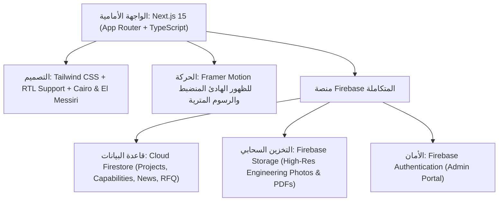
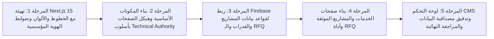

# المخطط الهندسي والمعماري المتكامل للمنصة الرقمية الجديدة
# CGL Next-Gen Enterprise Platform Blueprint
**Creative Geotechnical Laboratories (CGL) | مختبرات المبدعون الجيوتقنية**
*Next.js 15 • Firebase • Tailwind CSS • Framer Motion*

---

## 1. فلسفة الهوية والتصميم المؤسسي (Visual Direction: Premium Engineering Enterprise)

### 1.1 المفهوم البصري: السلطة التقنية والمؤسسية الهندسية (Institutional Engineering & Technical Authority)
* **الهوية المعتمدة:**
  * منصة مؤسسية ذات سلطة هندسية رصينة (**Premium Engineering Enterprise / Institutional Engineering / Technical Authority**).
  * تعكس واقع شركة هندسية عريقة تمتلك خبرة تشغيلية ومختبرات ومعدات متطورة ومشاريع ميدانية حقيقية، بعيداً تماماً عن طابع الشركات الناشئة (Tech Startup)، شركات البرمجيات، أو الوكالات الإعلانية الإبداعية (Creative Agency).
* **مرتكزات الواقعية والتوثيق الهندسي (Architectural Realism & Technical Documentation):**
  * **استخدام لغة الـ CAD ومخططات الهندسة كلغة وظيفية حقيقية** لترتيب وهيكلة المعلومات، وليس كمجرد زخرفة بصرية فارغة.
  * استلهام جماليات التوثيق التقني: جداول طبقات الأرض والجسات (Borehole Logs)، مراجع المسح الطبوغرافي ونقاط المناسيب، سجلات ضبط الجودة المخبرية، والرسومات الإنشائية.
  * الاعتماد على التوثيق البصري للموقع والمختبر (Site & Laboratory Documentation) والتصوير الميداني الحقيقي للمشاريع والمعدات.
  * طباعة تقنية دقيقة وهرمية معلومات بالغة الوضوح والتنظيم (Structured Information Hierarchy).
* **الممنوعات البصرية الصارمة (Strictly Forbidden):**
  * يُمنع منعاً باتاً أي جماليات خيالية أو نمط الذكاء الاصطناعي المستقبلي (Futuristic AI Aesthetic).
  * يُمنع استخدام تأثيرات التوهج الأزرق المشع (Glowing Blue Effects) أو العناصر الهولوجرافية العائمة (Floating Holographic Elements).
  * يُمنع استخدام الزجاجية المفرطة (Excessive Glassmorphism) أو المجسمات ثلاثية الأبعاد العشوائية (Random 3D Objects).
  * يُمنع استخدام التدرجات اللونية الفاقعة (Excessive Gradients) وتأثيرات النيون (Neon Effects).
  * يُمنع الإفراط الحركي في الواجهات (Over-animated Interfaces) أو أي مؤثرات لا تخدم سياقاً هندسياً مباشراً.
  * تجنب أي لغة تصميمية توحي بأن CGL شركة برمجيات أو ذكاء اصطناعي.
* **الشخصية البصرية المطلوبة (Visual Personality):**
  * **Authoritative — Precise — Established — Technical — Reliable — Modern — Institutional**
  * الحركة والتفاعل: استخدام الـ Animation بأسلوب هادئ ومنضبط وهادف فقط (**Restrained & Purposeful**)، يدعم الإحساس بدقة القياس والانتقال الهندسي، وليس الاستعراض البصري.

---

### 1.2 منظومة الخطوط والطباعة (Typography System)

#### اللغة العربية (Arabic First):
1. **خط العناوين الفاخرة (font-display):**
   * **خط المسيري (El Messiri)**
   * الاستخدام: العناوين الرئيسية (H1, H2)، وأرقام الإحصائيات الفخمة.
   * الوزن: SemiBold (600) و Bold (700).
   * الطابع: رصين، ذو انحناءات نحتية توحي بالأصالة والسيادة المؤسسية.
2. **الخط الأساسي للمحتوى وقراءة النصوص (font-sans):**
   * **خط كايرو (Cairo)**
   * الاستخدام: نصوص الفقرات، القوائم، أزرار التفاعل، البيانات الميدانية، والجداول الفنية.
   * الأوزان: Regular (400), Medium (500), SemiBold (600).
   * خصائص السطر: `line-height: 1.8` لقراءة مريحة ودقيقة في المصطلحات الهندسية.

#### اللغة الإنجليزية (Complementary English):
* **عناوين (Display):** `Cabinet Grotesk` أو `Outfit`
* **متن وقراءة (Sans):** `Plus Jakarta Sans` أو `Inter`

---

### 1.3 باليت الألوان الهندسية (Industrial Enterprise Color Palette)

| اللون | كود اللون | الاستخدام والدلالة |
|---|---|---|
| **Deep Slate (صخر الأساس)** | `#090E17` / `#0F172A` | لون الخلفيات الداكنة الفاخرة، الهيدر، والفوتر المؤسسي. |
| **Earth Gold / Brass (النحاس والتربة الذهبية)** | `#C5A880` / `#D4AF37` | لون التمييز الملكي (Accents)، الحدود الدقيقة، والأرقام القياسية. |
| **Safety Amber (أصفر الأمان الهندسي)** | `#F59E0B` | أزرار الإجراءات الحاسمة (CTA)، شارات الاعتماد، وحالات التحميل. |
| **Architectural White (أبيض ناصع معتدل)** | `#F8FAFC` / `#FFFFFF` | خلفيات الأقسام الفاتحة لتسهيل القراءة وتوضيح التقارير. |
| **Steel Gray (رمادي حديدي صناعي)** | `#334155` / `#64748B` | النصوص التوضيحية والخطوط الشبكية المترية. |

---

## 2. قواعد مصداقية البيانات والمحتوى (Data Integrity & Content Rules)

> [!IMPORTANT]
> **قاعدة سلامة البيانات الصارمة (Data Integrity Rule):**
> **"CGL website must never fabricate technical, operational, certification, client, project, statistical, or performance data."**
> يُحظر تماماً اختراع أي بيانات تقنية أو أرقام مشاريع أو أعماق حفر أو أسماء عملاء أو نتائج اختبارات أو شهادات غير موثقة. أي معلومة غير مؤكدة حالياً يجب أن تكون إما مخفية لحين التحقق منها، أو معلّمة بوضوح كـ **Placeholder** داخل الـ CMS، ولا يتم نشرها في الواجهة إلا بعد اعتمادها رسمياً من إدارة CGL.

### مبدأ المحتوى: الدليل قبل الادعاء (CLAIM → EVIDENCE)
يخضع كل محتوى الموقع لمبدأ الإثبات المباشر، والابتعاد عن العبارات التسويقية الضخمة غير القابلة للتحقق:
* **ادعاء "الخبرة التشغيلية الممتدة"** ← يُثبت عبر: سجل المشاريع المنفذة الفعلي وتاريخ الشركة الموثق.
* **ادعاء "القدرات الفنية المتقدمة"** ← يُثبت عبر: مواصفات المعدات الدقيقة والقدرات التشغيلية (Capabilities) المنهجية.
* **ادعاء "الجودة والاعتماد"** ← يُثبت عبر: الوثائق والشهادات الرسمية مع أرقامها وجهات إصدارها ونطاقها.
* **ادعاء "الريادة في قطاع محدد"** ← يُثبت عبر: دراسات حالة (Case Studies) ومشاريع منجزة فعلياً في ذلك القطاع.

---

## 3. الهيكلية البرمجية والتقنية (Technical Architecture)

---

## 4. الهيكل التفصيلي لصفحات المنصة (Complete Sitemap & Page Blueprints)

### 4.1 الصفحة الرئيسية (The Flagship Homepage)
* **Hero Section المؤسسي الموزون:**
  * وثائق وصور حقيقية عالية الجودة لعمليات الحفر الميداني واختبارات التحميل ليلاً ونهاراً.
  * عنوان رئيسي رصين بخط المسيري: يعكس القوة الهندسية والدقة المخبرية.
  * مؤشرات موثقة ومتحقق منها فقط (المؤشرات غير المؤكدة تبقى معطلة أو تُحدّث بالبيانات الفعلية من الإدارة).
* **شريط الشركاء والجهات المتعامل معها (Client & Partner Trust):** يُعرض فقط الشركاء المصرح بنشر شعاراتهم رسميًا.
* **مصفوفة الخدمات الهندسية السبعة (Technical Engineering Matrix):** عرض منهجي للركائز السبع مرتبطاً بالمعايير الهندسية المعمول بها.
* **المشاريع الميدانية المختارة (Featured Technical Projects):** عرض المشاريع كأدلة فنية (Evidence-based).
* **جاهزية الأسطول والقدرات التشغيلية (Proof of Operational Capabilities):** إبراز المنهجية والمعدات المستخدمة.
* **باني طلبات التسعير الهندسي (Engineering RFQ Builder):** نموذج منظم للمقاولين لطلب عروض أسعار دقيقة.

---

### 4.2 صفحة "عن الشركة والاعتمادات" (About CGL & Trust Evidence)
* **الامتداد الهندسي والشراكة مع CGI:** توثيق العلاقة المهنية ونقل المعايير والخبرات الفنية الأمريكية وتطبيقها محلياً.
* **الرؤية والرسالة والقيم الهندسية:** الالتزام بالسلامة الإنشائية، المسؤولية المهنية، وحيادية النتائج المخبرية.
* **أدلة الامتثال والاعتمادات (Certifications as Trust & Compliance Evidence):**
  * لا تُعرض الشهادات كـ "جدار شعارات للديكور"، بل كـ **وثائق اعتماد رسمية قابلة للتحقق**:
    * **اسم الشهادة / الاعتماد (Certification / Accreditation Name)**
    * **الجهة المصدرة (Issuing Organization)**
    * **رقم الشهادة المعتمد (Certificate Number)**
    * **نطاق الاعتماد المحدد (Verified Scope of Accreditation)**
    * **تاريخ الإصدار وتاريخ الانتهاء (Issue & Expiry Dates)**
    * **المختبر أو المنشأة المعنية بالاعتماد (Applicable Facility / Laboratory)**
    * **نسخة رسمية للتحميل (Official Certificate PDF)**
    * **رابط التحقق الرسمي إن وجد (Verification Link)**
  * **مهم جداً:** لا يُذكر حصول CGL على أي اعتماد (ISO أو غيره) ولا تُستخدم عبارة "Certified / Accredited" إلا بعد مطابقة الوثيقة الرسمية والتحقق منها.

---

### 4.3 بوابة الخدمات الهندسية (7 صفحات خدمات تفصيلية متخصصة)
لكل خدمة صفحة متكاملة تشرح: **النطاق الفني، المعايير والمواصفات المعمول بها، الأجهزة المستخدمة، ومخرجات التقارير**:
1. **استكشاف التربة والدراسات الجيوتقنية (Geotechnical & Soil Investigation)**
2. **تقييم سلامة المباني والفحوصات غير الإتلافية (Structural Integrity & NDT)**
3. **مختبرات فحص مواد البناء (Construction Materials Testing)**
4. **أعمال المسح الهندسي والجيوديسي (Land Surveying & Geomatics)**
5. **اختبارات التعدين والجيولوجيا (Mining & Material Analysis)**
6. **التدعيم ونزح المياه الجوفية (Shoring Systems & Dewatering)**
7. **الفحوصات والدراسات البيئية (Environmental Field Testing)**

---

### 4.4 معرض المشاريع كأدلة فنية (Projects as Technical Evidence)
بدلاً من الاكتفاء بصور ووصف تسويقي عام، يتم تقديم كل مشروع كـ **دليل هندسي موثق (Technical Evidence)** يعكس الكفاءة التشغيلية الحقيقية لـ CGL:

#### البنية الهرمية للمعلومات (Information Hierarchy لكل مشروع):
* **Project Name:** اسم المشروع الفعلي
* **Project Type / Sector:** قطاع المشروع (بنية تحتية، أبراج، صناعي، إلخ)
* **Location:** المدينة والموقع الجغرافي
* **Client:** اسم العميل — *فقط إذا كان النشر مسموحاً به تعاقدياً ورسمياً*
* **Scope of Work:** نطاق العمل الهندسي الموكل لـ CGL
* **Services Performed:** الخدمات المحددة التي نفذتها الشركة
* **Technical Challenges:** التحديات الجيوتقنية أو الإنشائية في الموقع (مثل ارتفاع منسوب المياه، طبيعة الصخور، إلخ)
* **Engineering Approach:** المنهجية الهندسية المتبعة لحل التحديات وضمان دقة الفحص
* **Tests / Investigations Performed:** الفحوصات المنفذة ميدانياً ومخبرياً
* **Equipment / Methods Used:** المعدات وطرق الاختبار المستخدمة (عند توفرها وتوثيقها)
* **Technical Metrics:** المؤشرات والأرقام الفنية الموثقة رسمياً فقط (دون أي اختراع لأرقام)
* **Project Gallery:** توثيق مصور عالي الجودة للعمليات الميدانية الفعلية
* **Relevant Standards:** المواصفات والمعايير الهندسية المطبقة في المشروع
* **Related CGL Services:** روابط الخدمات المرتبطة داخل المنصة

> **نموذج عرض البيانات (Data Hierarchy Example):**
> * **PROJECT:** High-Rise Development
> * **LOCATION:** Riyadh
> * **SCOPE:** Geotechnical Investigation
> * **FIELD WORK:** Boreholes / SPT / Sampling
> * **LABORATORY:** Soil Classification / Strength Testing
> * يتبعه شرح مختصر للتحدي والحل الهندسي والنتيجة الموثقة.

---

### 4.5 مركز القدرات التشغيلية والأسطول (Proof of Operational Capability)
لا يتم تقديم المعدات والقدرات كمعرض استعراضي بصري، بل كـ **إثبات للكفاءة التشغيلية الميدانية والمخبرية (Proof of Operational Capability)**:

#### هيكل بيانات كل قدرة تشغيلية (Capability Schema):
* **Capability Name:** اسم القدرة الفنية (مثل: Deep Ground Investigation)
* **Application:** مجالات التطبيق العملية
* **Field / Laboratory:** تصنيف القدرة (ميدانية أم مخبرية)
* **Equipment Used:** المعدات المستخدمة فعلياً
* **Testing / Investigation Methods:** طرق الاختبار والتحري الفنية (مثل: Rotary Drilling, Sampling, SPT)
* **Capacity / Range:** نطاق الطاقة والقدرة التشغيلية الموثقة للمعدة
* **Applicable Standards:** المعايير والمواصفات القياسية المرتبطة بها (عند التحقق منها)
* **Typical Deliverables:** المخرجات والتقارير الفنية المستلمة من هذه العملية
* **Related Services:** الخدمات المرتبطة
* **Related Projects:** المشاريع التي تم تطبيق هذه القدرة فيها عملياً

> **المبدأ:** الزائر لا يرى مجرد صورة معدة، بل يدرك: *"لدى CGL قدرة تشغيلية واضحة، وتعي أين تُستخدم، وكيف تُنفّذ، وما هي مخرجاتها الهندسية المعتمدة."*

---

### 4.6 حاسبة طلب عرض السعر الهندسي (Interactive RFQ Portal)
أداة مهنية دقيقة للمقاولين والمكاتب الاستشارية لطلب تسعير الفحوصات:
* تحديد القطاع والخدمة المطلوبة.
* إدخال معالم الموقع والمساحة والعمق التقديري.
* إمكانية إرفاق كراسة الشروط أو المخطط الهندسي (PDF / CAD).
* إرسال الطلب فوراً إلى قاعدة البيانات، مع إشعار إدارة المشاريع والمبيعات.

---

### 4.7 لوحة التحكم الإدارية (Enterprise CMS Portal)
* تأمين الدخول بواسطة **Firebase Authentication**.
* إدارة المشاريع وفق هيكل الـ Technical Evidence مع حقول واضحة ومحددة.
* إدارة القدرات التشغيلية والمعدات وفق بنية الـ Operational Capabilities.
* إدارة وثائق الاعتماد والشهادات وسجل صلاحياتها.
* **التزام برمجيات الـ CMS بقاعدة سلامة البيانات:** الحقول غير المتوفرة تُترك كـ Placeholders واضحة ولا تُعرض على الموقع العام إلا بعد الاعتماد.

---

## 5. خطة التنفيذ الميداني والخطوات التالية

